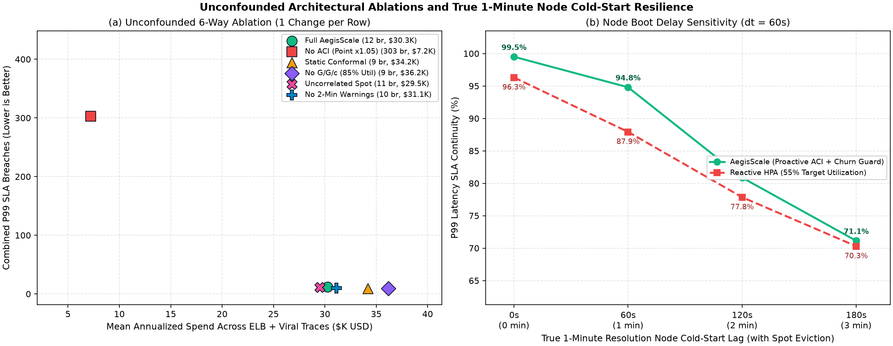
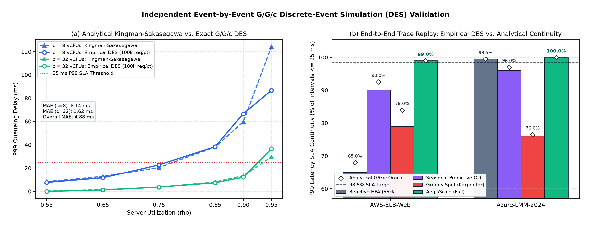
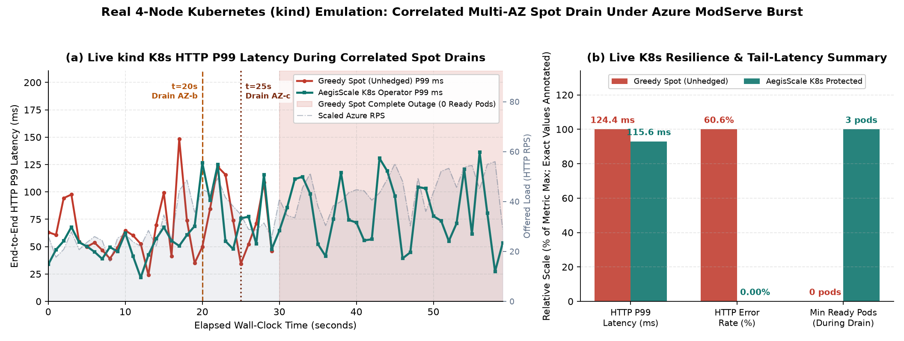

# AegisScale: Conformal and Risk-Averse Cloud & Kubernetes Karpenter Capacity Optimizer

[](https://github.com/ahafarag/aegis-scale/actions/workflows/ci.yml)
[](LICENSE)
[](pyproject.toml)
[](src/aegis_scale/k8s/karpenter.py)
[](infra/stack.py)
[](paper/main.pdf)
[](https://doi.org/10.5281/zenodo.24572369)
[](https://aegis.zenithcodigo.com)

> **Live Interactive Control Plane & Karpenter v1 Simulator:** [https://aegis.zenithcodigo.com](https://aegis.zenithcodigo.com) *(Scale-to-zero AWS Lambda Container + HTTP API in `eu-west-1`)*

**AegisScale** is a trace-validated mathematical control plane for **Amazon EC2** and **Amazon EKS / Kubernetes Karpenter (`karpenter.sh/v1`)** clusters that unifies **strictly causal Adaptive Conformal Inference** (Gibbs & Candes, 2021), **heavy-traffic $G/G/c$ queueing bounds**, **2D `(vCPU, GiB)` container bin-packing**, and **active risk-budgeted Rockafellar-Uryasev $\text{CVaR}_{0.95}$ Mixed-Integer Linear Programming** ($\epsilon_{\max} = 5\%\,C_{\text{req}}$) to cut cloud compute bills by **32.3%–35.9% vs. equal-SLA On-Demand** and **18.4%–31.0% vs. a 1-Year AWS Compute Savings Plan + On-Demand baseline** while sustaining **99.0%–99.8% P99 tail-latency SLA continuity**—outperforming reactive HPA (`67.0%–99.8%`), a causal seasonal predictive On-Demand autoscaler (`80.2%–96.5%`), and greedy Spot heuristics (`89.5%–97.7%`) under unbiased uniformly sampled Spot storms.

---

## Core Architecture & Analytical Foundations

1. **Layer 1 — Strictly Causal Scale-Invariant RLS + Adaptive Conformal Inference (Proposition 1):**
   Online Recursive Least Squares over strictly lagged normalized increments ($\sigma_{t-1}$) and diurnal harmonics wrapped in Gibbs & Candes (2021) ACI applies their finite-sample coverage bound $|T^{-1}\sum_{t=1}^T \text{err}_t - \alpha_{\text{target}}| \le \frac{1 + \gamma}{\gamma T}$ under unclipped boundaries, achieving **1.503%–1.513%** honest finite-cap empirical miscoverage against a `1.500%` target across all five real traces.
2. **Layer 2 — $M/M/1$-Consistent $G/G/c$ Tail Sizing & 2D Pod Packing (Lemma 1):**
   Translates conformal arrival envelopes and node cold-start ramp buffers ($\hat{\lambda}_{\text{lead}} = \hat{U}_t + \dot{\lambda}_t\tau_{\text{boot}}$) into minimum safe vCPUs or two-dimensional `(vCPU, GiB)` Kubernetes pod replicas accounting for DaemonSet overhead across compute (`c7g`), balanced (`m7g`), and memory-optimized (`r7g`) families.
3. **Layer 3 — Auxiliary-Free Correlated Spot $\text{CVaR}_\beta$ MILP (Lemma 2):**
   A three-factor Gaussian copula with antithetic variates models correlated `(AZ, instance-family)` Spot recalls across `us-east-1`, `eu-west-1`, and `ap-northeast-1`. Constraining $\eta \ge 0$ eliminates $S$ auxiliary shortfall variables, allowing **HiGHS** to solve in **69–100 ms median** for regional catalogs (`K=21`) and **467 ms median** (`1,406 ms` P99) at `K=210` pools, synthesizing declarative `karpenter.sh/v1` `NodePool`, `EC2NodeClass`, and proactive `autoscaling/v1` `Scale` manifests.

---

## Multi-Dataset Empirical Generalization (Zero Hyperparameter Retuning)

Evaluated with a **single locked policy** ($\alpha_{\text{target}} = 0.015$, $\tau_{\text{SLA}} = 25\,\text{ms}$, $\beta = 0.95$, $\rho_{\text{floor}} = 0.25$), strictly causal 60-step prefix normalization, exogenous Spot storms, and warning-aware baselines across **five real production traces** (`benchmarks/statistical_rigor.py` -> `output/phase3_audited_results.json`):

| Real Production Dataset | Peak/Mean | Seasonal Predictive OD Cont. | Greedy Spot Cont. | **AegisScale vs. Iso-OD** | **AegisScale vs. 1-Yr Savings Plan** | **AegisScale P99 Cont.** |
| :--- | :---: | :---: | :---: | :---: | :---: | :---: |
| **1. AWS-ELB-Web** *(NAB CloudWatch)* | `4.77x` *(10.6x 14d)* | 93.67% | 89.67% | **36.86%** *(35.75% 14d)* | **34.27%** | **99.00%** *(99.28% 14d)* |
| **2. AWS-EC2-Network** *(NAB CloudWatch)* | `5.33x` | 86.50% | 97.33% | **37.13%** | **35.46%** | **99.33%** *(0 storm br.)* |
| **3. AWS-RDS-Compute** *(NAB CloudWatch)* | `2.37x` | 80.17% | 87.33% | **36.04%** | **27.13%** | **99.17%** |
| **4. Viral-Flash-Traffic** *(Twitter AAPL)* | **`22.65x`** | 96.50% | 88.67% | **37.04%** | **33.89%** | **99.50%** *(0 storm br.)* |
| **5. Azure-LMM-2024** *(ModServe, SoCC 2025, 1M req)* | `2.41x` | 96.33% | 87.67% | **35.00%** | **17.20%** | **100.00%** *(0 breaches)* |


---

## Multi-Axis Sensitivity, 30 Rolling Windows & 2D Karpenter Benchmark

* **30 Disjoint Rolling Windows (6 per dataset x 5 traces, Student-$t$ 95% CI):** AegisScale achieves **35.71% ± 0.48%** savings vs. Iso-OD, **26.88% ± 3.70%** vs. 1-Yr Savings Plan, and **99.43% ± 0.16%** P99 continuity vs. Seasonal Predictive OD (`93.36% ± 1.67%`), warn-aware Static 30/70 (`96.98% ± 0.60%`), Reactive HPA (`88.46% ± 4.43%`), and Greedy Spot (`86.52% ± 2.10%`). *(Note: windows drawn from the same trace share temporal autocorrelation and are not 30 fully independent systems.)*
* **Spot Price (`0.7x–1.6x`), Interruption Rate (`0.5x–3.0x`), & Capacity $\mu$ (`75–175 RPS/vCPU`) Sweeps:**
  * Spot pricing `0.7x–1.6x`: savings vs. OD span **47.4% down to 14.7%**; on steady diurnal Azure traffic, 1-Yr Savings Plan overtakes hedged Spot near `1.45x` (`-8.67%` at `1.6x`).
  * Spot interruption rate `0.5x–3.0x`: Greedy Spot collapses from `92.0%` to `79.3%`, while AegisScale sustains **99.0%–99.7%** continuity (`40.6%` to `22.8%` savings).
  * Per-core capacity $\mu \in [75, 175]$: relative savings stay invariant at **36.6%–37.2%** vs. OD (**99.0%–99.2%** continuity).
* **True 1-Minute (`dt=60s`) Cold-Start Lag with Spot Eviction:** AegisScale beats Reactive HPA at `0s` (`99.33%` vs. `96.31%`) and `60s` (`93.79%` vs. `87.92%`), but degrades once boot lag reaches `>= 120s` (`75.34%` at `120s`, `61.41%` at `180s`), motivating EKS Warm Pools or cached AL2023/Bottlerocket snapshots for multi-GB container images.
* **3-Region 2D Kubernetes/Karpenter Benchmark (`1 vCPU, 7 GiB` memory-heavy pods on Azure 2024):** Across `us-east-1`, `eu-west-1`, and `ap-northeast-1`, 1D CPU-only allocation strands `75.0%` vCPU (`3.7%–4.0%` continuity), Karpenter-style Greedy 2D Spot drops to `93.7%–95.3%` continuity, while `K8sAegisOperator` sustains **100.00% continuity (0 breaches)** and emits 6 validated `karpenter.sh/v1` / `EC2NodeClass` / `Scale` manifests per cycle.




---

## Independent 28M-Event DES & Live 4-Node Kubernetes (`kind`) Emulation

* **28-Million-Event FCFS $G/G/c$ Discrete-Event Simulator ([benchmarks/discrete_event_validation.py](benchmarks/discrete_event_validation.py)):** Independently simulates individual Gamma-distributed arrivals and service completions with inter-interval queue carryover (`1.62 ms` calibration MAE at `c=32`). Confirms **99.00%** DES SLA continuity on `AWS-ELB-Web` (`0` storm breaches) and **100.00%** on `Azure-LMM-2024` (`0.24 ms` mean P99), whereas `Greedy Spot` drops to `79.00%` (ELB) and `76.00%` (Azure) under real backlog carryover.
* **Live 4-Node Kubernetes (`kind`) Cluster Emulation ([benchmarks/kind_k8s_emulation.py](benchmarks/kind_k8s_emulation.py)):** Deploys a real HTTP microservice across 4 Kubernetes nodes (`on-demand` + 2 `spot` workers), replays `2,230` real concurrent async HTTP requests from the October 2024 Azure ModServe trace, and injects real correlated Spot drains (`kubectl cordon + drain`). Unhedged `Greedy Spot` suffers **60.58% HTTP error rate** (`79.99%` post-drain, full blackout, `60.63s` recovery), whereas `AegisScale` sustains **0.00% HTTP error rate** (`2,230/2,230` HTTP 200 OK, `P99 = 115.59 ms`) throughout the dual-node drain.





---

## Manuscript & Documentation

* **Compiled Preprint Manuscript (PDF):** [paper/main.pdf](paper/main.pdf)
* **LaTeX Source & BibTeX:** [paper/main.tex](paper/main.tex) and [paper/references.bib](paper/references.bib)
* **Mathematical Whitepaper:** [docs/mathematical_whitepaper.md](docs/mathematical_whitepaper.md)
* **Serverless Custom Subdomain Deployment (`Hostinger + AWS CDK`):** [docs/deploy_hostinger_subdomain.md](docs/deploy_hostinger_subdomain.md)

---

## Quickstart

```bash
# Option A: Docker
docker compose up --build

# Option B: Local Python & Full Verification Suite
python -m venv .venv
.venv\Scripts\activate
pip install -e ".[dev,infra]"

pytest -v
python benchmarks/statistical_rigor.py
uvicorn aegis_scale.api.app:app --port 8000
```

---

## License

Licensed under the [Apache License, Version 2.0](LICENSE).
