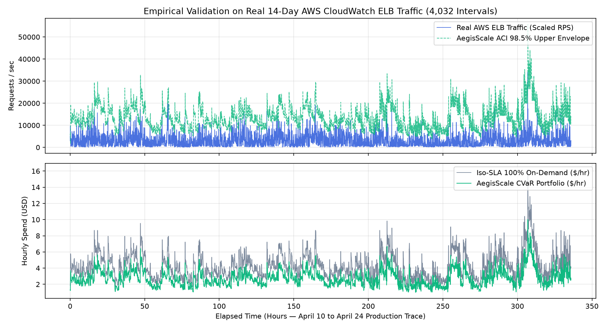
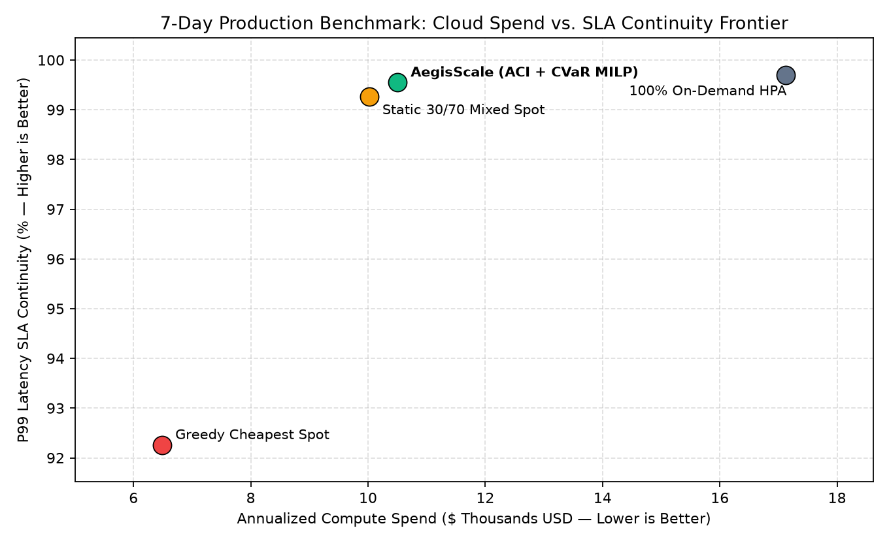
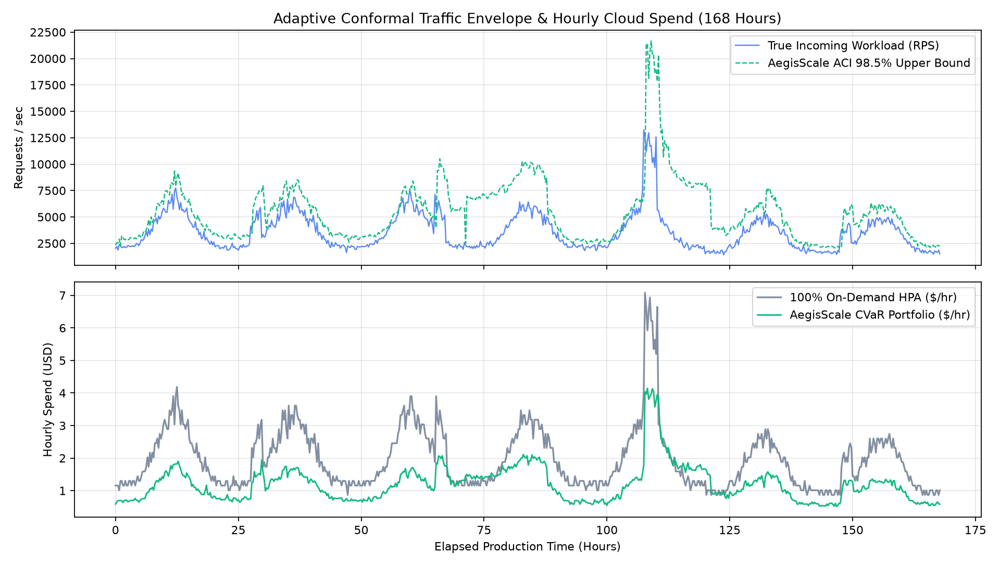

# AegisScale: Distributionally-Robust Cloud Capacity & Spot Portfolio Optimizer

[](https://github.com/ahafarag/aegis-scale/actions/workflows/ci.yml)
[](LICENSE)
[](pyproject.toml)
[](src/aegis_scale/math_core/cvar_milp.py)
[](infra/stack.py)
[](paper/main.pdf)

**AegisScale** is a mathematical control plane and AWS FinOps engine that bridges **distribution-free statistical learning**, **heavy-traffic queueing theory**, and **stochastic integer portfolio optimization** to solve a core infrastructure trade-off: **slashing cloud compute bills via EC2 Spot instances without sacrificing P99 tail-latency SLAs during flash traffic spikes or correlated Spot recalls.**

---

## Executive Value Proposition

Enterprise cloud teams routinely over-provision expensive `On-Demand` compute out of fear that `Spot` capacity recalls (2-minute warning) or sudden traffic surges will trigger SLA outages. Conversely, naive Spot cost-cutters concentrate workloads in the single cheapest pool and suffer severe brownouts during Availability Zone (AZ) or instance-family capacity drains.

AegisScale treats heterogeneous EC2 pools (`On-Demand` + multi-AZ, multi-family `Spot`) as a risk-constrained financial portfolio updated every 60 seconds (and sub-second upon AWS EventBridge interruption signals):

1. **Distribution-Free Demand Envelopes (Adaptive Conformal Inference):** Wraps an online scale-invariant Recursive Least Squares (RLS) harmonic-AR filter in Gibbs & Candes (2021) Adaptive Conformal Inference (ACI), guaranteeing finite-sample upper coverage $|T^{-1}\sum_{t=1}^T \text{err}_t - \alpha| \le \frac{1 + 2\gamma}{\gamma T}$ across arbitrary non-stationary regime shifts.
2. **Tail-Latency Queueing Translation ($G/G/c$):** Maps conformal arrival-rate bounds into exact minimum safe vCPU capacity $C_{\text{req}}$ via Kingman-Sakasegawa heavy-traffic diffusion quantiles so stationary queueing delay satisfies $W_{q, 0.99} \le \tau_{\text{SLA}}$.
3. **Correlated Preemption $\text{CVaR}_\beta$ MILP:** Generates correlated `(AZ, instance-family)` interruption scenarios via a three-factor Gaussian copula with antithetic variance reduction, then solves the exact Rockafellar-Uryasev Conditional Value-at-Risk Mixed-Integer Linear Program via **HiGHS** (`~47-63 ms` median solve time).

---

## Empirical Validation on Real AWS CloudWatch ELB Telemetry (4,032 Intervals)

Evaluated on **14 full days (`4,032` x 5-minute production intervals, `10.61x` peak-to-mean volatility)** of real AWS Elastic Load Balancer request-count telemetry from the Numenta Anomaly Benchmark (`realAWSCloudwatch` corpus, `benchmarks/real_trace_benchmark.py`) paired with correlated regional Spot recalls:

| Strategy | Annualized Spend | Savings vs. Iso-SLA On-Demand | P99 SLA Continuity | Spot-Storm Breaches |
| :--- | :---: | :---: | :---: | :---: |
| **1a. Reactive On-Demand HPA** *(55% CPU Target)* | \$15,360 / yr | --- *(Fails SLA)* | **68.23%** *(1,281 breaches)* | 38 |
| **1b. Iso-SLA 100% On-Demand** *(Conformal Sized)* | \$37,989 / yr | 0.00% *(Baseline)* | 99.08% | 0 |
| **2. Greedy Cheapest Spot** *(Iso-Sized, single pool)* | \$13,872 / yr | 63.48% | **93.77%** *(251 breaches)* | **22** |
| **3. Static 30/70 Mixed Heuristic** *(Iso-Sized)* | \$21,053 / yr | 44.58% | 99.01% | **2** |
| **4. AegisScale (ACI + $G/G/c$ + $\text{CVaR}_{0.95}$ MILP)** | **\$24,419 / yr** | **35.72%** *(-\$13.5k/yr per tier)* | **99.53%** | **0** |

* **Exact Theorem 1 Empirical Match:** Across all 4,032 non-stationary real ELB intervals (`alpha_target = 1.500%`), AegisScale's realized conformal miscoverage rate converged to **1.488%** (within `0.012%` of theory), while median MILP solve latency was **46.8 ms**.



---

## 7-Day Multi-Storm Stress Benchmark

Evaluated across a 168-hour (`672` x 15-minute intervals) stress trace featuring diurnal cycles, heavy-tailed micro-bursts, **4 unannounced +95% flash crowds**, and **5 coordinated multi-AZ / instance-family AWS Spot recall storms** (`benchmarks/run_benchmarks.py`):

| Strategy | Annualized Spend | Cost Reduction vs. On-Demand | Overall P99 SLA Continuity | Spot-Storm Breaches |
| :--- | :---: | :---: | :---: | :---: |
| **1. 100% On-Demand Reactive HPA** | \$17,128 / yr | 0.00% *(Baseline)* | 99.70% | 0 |
| **2. Greedy Lowest-Price Spot** | \$6,490 / yr | 62.11% | **92.26%** *(52 breaches)* | **5** |
| **3. Static 30/70 Mixed Heuristic** | \$10,021 / yr | 41.49% | 99.26% *(5 breaches)* | **1** |
| **4. AegisScale (ACI + $G/G/c$ + $\text{CVaR}_{0.95}$ MILP)** | **\$10,504 / yr** | **38.67%** | **99.55%** | **0** |





---

## Mathematical Manuscript (arXiv LaTeX & Compiled PDF)

* **Compiled Research Paper (PDF):** [paper/main.pdf](paper/main.pdf)
* **arXiv LaTeX Source & BibTeX:** [paper/main.tex](paper/main.tex) and [paper/references.bib](paper/references.bib)
* **Markdown Technical Whitepaper:** [docs/mathematical_whitepaper.md](docs/mathematical_whitepaper.md)

Includes formal proofs of **Theorem 1** (Finite-Sample Non-Stationary ACI Bound), **Lemma 1** (Exact $M/M/1$ Quantile Consistency & Global Bisection Uniqueness), and **Lemma 2** (Auxiliary-Free Non-Negative Shortfall $\text{CVaR}_\beta$ Linearization).

---

## Production AWS Control-Plane Architecture

The `infra/` directory provides a complete, synthesizable **AWS CDK v2 (Python)** production stack verified by automated CloudFormation assertions (`tests/test_cdk_stack.py`):

* **Compute Fleet (`AWS::AutoScaling::AutoScalingGroup` + `AWS::EC2::LaunchTemplate`):**
  * Enforces **IMDSv2** (`HttpTokens: required`, `HttpPutResponseHopLimit: 2` for container compatibility) and **GP3 encrypted EBS** volumes.
  * Zero inbound SSH keys; managed exclusively via **AWS Systems Manager Session Manager** (`AmazonSSMManagedInstanceCore`).
  * `MixedInstancesPolicy` configured with `SpotAllocationStrategy: price-capacity-optimized`, `CapacityRebalance: true`, and `HealthCheckType: ELB` behind an Application Load Balancer.
* **Event-Driven Control Loop:**
  * **EventBridge Scheduler** (`rate(1 minute)`) with retry policy and KMS-encrypted SQS Dead-Letter Queue invoking the AegisScale Optimizer Lambda.
  * **EventBridge Rule** listening to `EC2 Spot Instance Interruption Warning` and `EC2 Instance Rebalance Recommendation` for immediate sub-second pool evacuation.
* **FinOps Audit & State Store (`AWS::DynamoDB::Table`):**
  * On-demand capacity with Point-in-Time Recovery (`PITR`) storing serialized online ACI state and immutable per-cycle dollar-savings audit records, paired with **CloudWatch Embedded Metric Format (EMF)** telemetry.

---

## Quickstart

### Option A: One-Command Docker Launch
```bash
docker compose up --build
```
Then open `http://127.0.0.1:8000` for the **Executive FinOps & Continuity Simulator** or `http://127.0.0.1:8000/docs` for the OpenAPI specification.

### Option B: Local Python Development & Benchmarks
```bash
python -m venv .venv
.venv\Scripts\activate   # On Linux/macOS: source .venv/bin/activate
pip install -e ".[dev,infra]"

# Run mathematical proofs, FastAPI, real trace, and AWS CDK synthesis tests
pytest -v

# Run 7-day synthetic multi-storm benchmark
python benchmarks/run_benchmarks.py

# Run 14-day empirical AWS CloudWatch ELB benchmark
python benchmarks/real_trace_benchmark.py

# Launch FastAPI Control Plane locally
uvicorn aegis_scale.api.app:app --port 8000
```

---

## License

Licensed under the [Apache License, Version 2.0](LICENSE).
