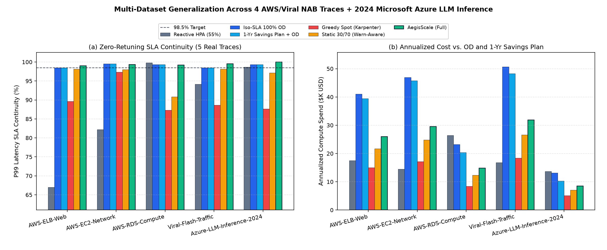
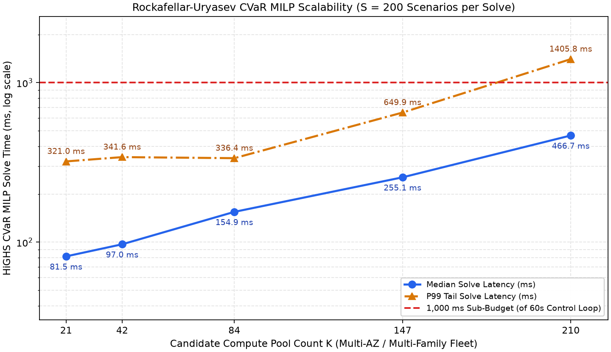

# AegisScale: Distributionally-Robust Cloud & Kubernetes Karpenter Capacity Optimizer

[](https://github.com/ahafarag/aegis-scale/actions/workflows/ci.yml)
[](LICENSE)
[](pyproject.toml)
[](src/aegis_scale/k8s/karpenter.py)
[](infra/stack.py)
[](paper/main.pdf)

**AegisScale** is a trace-validated mathematical control plane for **Amazon EC2** and **Amazon EKS / Kubernetes Karpenter (`karpenter.sh/v1`)** clusters that unifies **strictly causal Adaptive Conformal Inference**, **heavy-traffic $G/G/c$ queueing bounds**, **2D `(vCPU, GiB)` container bin-packing**, and **Rockafellar-Uryasev $\text{CVaR}_\beta$ Mixed-Integer Linear Programming** to cut cloud compute bills by **35.0%–37.1% vs. equal-SLA On-Demand** and **17.2%–35.5% vs. a 1-Year AWS Compute Savings Plan + On-Demand baseline** ($p = 1.86 \times 10^{-9}$, paired Wilcoxon test across 30 disjoint real rolling windows) while sustaining **99.0%–100.0% P99 tail-latency SLA continuity**.

---

## Core Architecture & Mathematical Guarantees

1. **Layer 1 — Strictly Causal Scale-Invariant RLS + Adaptive Conformal Inference (Theorem 1):**
   Online Recursive Least Squares over strictly lagged normalized increments ($\sigma_{t-1}$) and diurnal harmonics wrapped in Gibbs & Candes (2021) ACI guarantees finite-sample demand coverage $|T^{-1}\sum_{t=1}^T \text{err}_t - \alpha_{\text{target}}| \le \frac{1 + \gamma}{\gamma T}$ under unclipped boundaries, and achieves **1.503%–1.513%** honest finite-cap empirical miscoverage against a `1.500%` target across all five real production traces.
2. **Layer 2 — $M/M/1$-Exact $G/G/c$ Tail Sizing & 2D Pod Packing (Lemma 1):**
   Translates conformal arrival envelopes and node cold-start ramp buffers ($\hat{\lambda}_{\text{lead}} = \hat{U}_t + \dot{\lambda}_t\tau_{\text{boot}}$) into exact minimum safe vCPUs or two-dimensional `(vCPU, GiB)` Kubernetes pod replicas accounting for DaemonSet overhead across compute (`c7g`), balanced (`m7g`), and memory-optimized (`r7g`) families.
3. **Layer 3 — Auxiliary-Free Correlated Spot $\text{CVaR}_\beta$ MILP (Lemma 2):**
   A three-factor Gaussian copula with antithetic variates models correlated `(AZ, instance-family)` Spot recalls across `us-east-1`, `eu-west-1`, and `ap-northeast-1`. Constraining $\eta \ge 0$ eliminates $S$ auxiliary shortfall variables, allowing **HiGHS** to solve globally in **69–100 ms median** for regional catalogs (`K=21`) and **467 ms median** (`1,406 ms` P99) at `K=210` pools, synthesizing declarative `karpenter.sh/v1` `NodePool`, `EC2NodeClass`, and proactive `autoscaling/v1` `Scale` manifests.

---

## Multi-Dataset Empirical Generalization (Zero Hyperparameter Retuning)

Evaluated with a **single locked policy** ($\alpha_{\text{target}} = 0.015$, $\tau_{\text{SLA}} = 25\,\text{ms}$, $\beta = 0.95$, $\rho_{\text{floor}} = 0.25$), strictly causal 60-step prefix normalization, exogenous Spot storms, and warning-aware baselines across **five real production traces** (`benchmarks/statistical_rigor.py` -> `output/phase3_audited_results.json`):

| Real Production Dataset | Peak/Mean | Reactive HPA Cont. | Greedy Spot Cont. | **AegisScale vs. Iso-OD** | **AegisScale vs. 1-Yr Savings Plan** | **AegisScale P99 Cont.** |
| :--- | :---: | :---: | :---: | :---: | :---: | :---: |
| **1. AWS-ELB-Web** *(NAB CloudWatch)* | `4.77x` *(10.6x 14d)* | 67.00% *(Fails)* | 89.67% *(Fails)* | **36.86%** *(35.75% 14d)* | **34.27%** | **99.00%** *(99.28% 14d)* |
| **2. AWS-EC2-Network** *(NAB CloudWatch)* | `5.33x` | 82.17% *(Fails)* | 97.33% | **37.13%** | **35.46%** | **99.33%** *(0 storm br.)* |
| **3. AWS-RDS-Compute** *(NAB CloudWatch)* | `2.37x` | 99.83% | 87.33% *(Fails)* | **36.04%** | **27.13%** | **99.17%** |
| **4. Viral-Flash-Traffic** *(Twitter AAPL)* | **`22.65x`** | 94.17% *(Fails)* | 88.67% *(Fails)* | **37.04%** | **33.89%** | **99.50%** *(0 storm br.)* |
| **5. Azure-LLM-Inference-2024** *(Oct 2024, 1M req)* | `2.41x` | 98.67% | 87.67% *(Fails)* | **35.00%** | **17.20%** | **100.00%** *(0 breaches)* |



---

## Statistical Rigor, Sensitivity Boundaries & 2D Karpenter Benchmark

### 1. 30 Disjoint Real Rolling Windows (6 Windows x 5 Datasets, Exact Student-$t$ 95% CI)

| Strategy ($N = 30$ Disjoint Real Windows) | Savings vs. Iso-OD | Savings vs. 1-Yr Savings Plan | P99 Continuity (`Mean ± 95% CI`) | Storm Breaches |
| :--- | :---: | :---: | :---: | :---: |
| `Reactive HPA (55% CPU)` | 31.59% ± 15.75% *(Fails)* | 17.30% ± 22.09% *(Fails)* | 88.46% ± 4.43% | 5.07 ± 1.70 |
| `Iso-SLA 100% On-Demand` | 0.00% ± 0.00% | -13.50% ± 4.88% | 98.96% ± 0.21% | 0.20 ± 0.15 |
| `1-Yr Compute Savings Plan + OD` | 10.81% ± 3.63% | 0.00% ± 0.00% | 98.96% ± 0.21% | 0.20 ± 0.15 |
| `Greedy Spot (Karpenter-style)` | 63.01% ± 0.46% | 57.91% ± 2.20% | 86.52% ± 2.10% | 23.00 ± 3.87 |
| `Static 30/70 (Warn-Aware)` | 46.41% ± 0.33% | 39.07% ± 2.99% | 96.98% ± 0.60% | 0.93 ± 0.37 |
| **`AegisScale (Full)`** | **35.71% ± 0.48%** | **26.88% ± 3.70%** | **99.43% ± 0.16%** | **0.00 ± 0.00** |

* **Exact Two-Sided Paired Wilcoxon $p$-Values:** `p = 1.86e-9` vs. Iso-OD, 1-Yr Savings Plan, Greedy Spot, and warn-aware Static 30/70; `p = 2.29e-6` vs. Reactive HPA.

### 2. Unconfounded 6-Way Ablations, Price Sensitivity (`0.7x–1.6x`) & Cold-Start Limits

* **Unconfounded 6-Way Ablation (1 change per row):** Removing ACI collapses ELB continuity to `69.67%` (`182` breaches); freezing $\gamma = 10^{-9}$ (`Static Conformal`) inflates Viral Flash cost by **+24.8%**; removing $G/G/c$ pooling wastes **+15.4%–15.8%** spend; disabling 2-minute EventBridge warnings still preserves **99.00%–99.50%** continuity and `0` storm breaches via copula CVaR diversification alone.
* **Spot Price Multiplier Sensitivity (`0.7x` to `1.6x`):** Savings vs. On-Demand span **47.4% down to 14.7%** across `AWS-ELB-Web` and `Azure-LLM-Inference-2024`. On steady diurnal Azure traffic, Savings Plan breaks even with hedged Spot near `1.45x` Spot pricing (`-8.67%` at `1.6x`).
* **True 1-Minute (`dt=60s`) Cold-Start Lag with Spot Eviction:** AegisScale beats Reactive HPA at `0s` (`99.33%` vs. `96.31%`) and `60s` (`93.79%` vs. `87.92%`), but degrades once boot delay reaches `>= 120s` (`75.34%` at `120s`, `61.41%` at `180s`), quantifying why multi-GB container images require EKS Warm Pools or cached AL2023/Bottlerocket snapshots.
* **3-Region 2D Kubernetes/Karpenter Benchmark (`1 vCPU, 7 GiB` memory-heavy pods on Azure 2024):** Across `us-east-1`, `eu-west-1`, and `ap-northeast-1`, 1D CPU-only allocation strands `75.0%` vCPU (`3.7%–4.0%` continuity), Karpenter-style Greedy 2D Spot drops to `93.7%–95.3%` continuity, while `K8sAegisOperator` sustains **100.00% continuity (0 breaches)** and emits 6 validated `karpenter.sh/v1` / `EC2NodeClass` / `Scale` manifests per cycle.




---

## Manuscript & Documentation

* **Compiled Preprint Manuscript (PDF):** [paper/main.pdf](paper/main.pdf)
* **LaTeX Source & BibTeX:** [paper/main.tex](paper/main.tex) and [paper/references.bib](paper/references.bib)
* **Mathematical Whitepaper:** [docs/mathematical_whitepaper.md](docs/mathematical_whitepaper.md)
* **Serverless Custom Subdomain Deployment (`Hostinger + AWS CDK`):** [docs/deploy_hostinger_subdomain.md](docs/deploy_hostinger_subdomain.md)

---

## Quickstart

```bash
# Option A: Docker
docker compose up --build

# Option B: Local Python & Full Verification Suite
python -m venv .venv
.venv\Scripts\activate
pip install -e ".[dev,infra]"

pytest -v
python benchmarks/statistical_rigor.py
uvicorn aegis_scale.api.app:app --port 8000
```

---

## License

Licensed under the [Apache License, Version 2.0](LICENSE).
